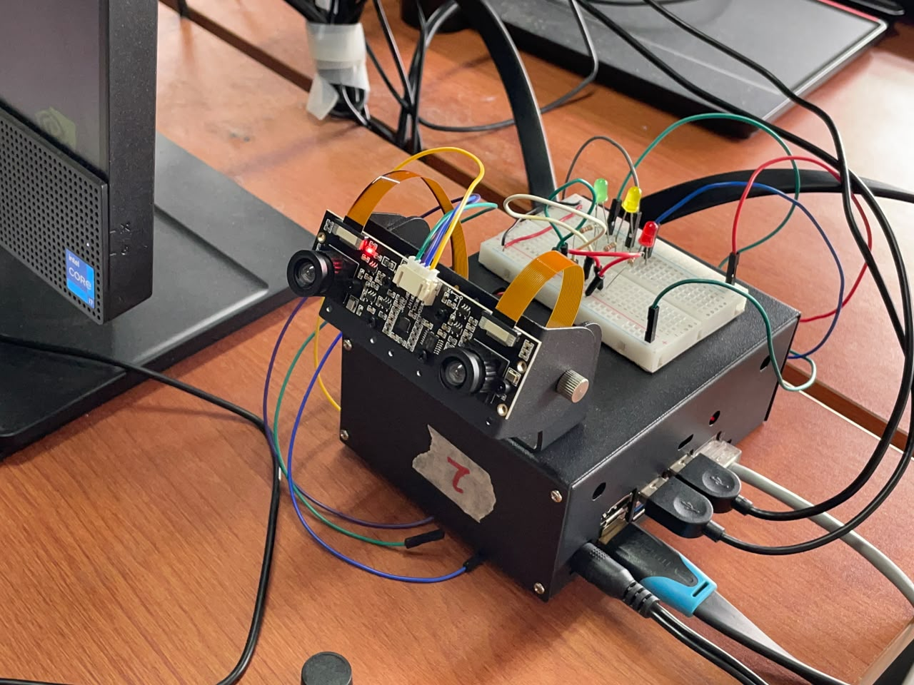

# 🚦 Traffic Sign Detection — Jetson Nano + TensorRT YOLOv8 + GPIO LEDs

Sistem deteksi rambu lalu lintas **real-time** berbasis **Jetson Nano** menggunakan
kamera CSI **IMX219**, model **YOLOv8** yang sudah dikonversi ke **TensorRT engine**,
serta indikator **3 LED** (STOP / SLOW / GO) yang dikendalikan melalui GPIO.

[](https://opensource.org/licenses/MIT)

---

## 📌 Ringkasan

Program menerima frame dari kamera CSI, menjalankan inferensi YOLOv8 pada GPU
Jetson melalui TensorRT, lalu mengklasifikasikan rambu ke dalam 3 kelas:
`stop`, `slow`, `go`. Kelas dengan confidence tertinggi yang **stabil selama
beberapa frame berturut-turut** akan menyalakan LED yang sesuai.

Model tersedia di folder `models/` sebagai **`best.engine`** (TensorRT) dan
**`best.onnx`**. Sesuaikan `ENGINE_PATH` di source code dengan lokasi repositori
di Jetson sebelum menjalankan program.

---

## 🧰 Spesifikasi Hardware

| Komponen              | Spesifikasi                                        |
|-----------------------|----------------------------------------------------|
| Board                 | NVIDIA Jetson Nano (4 GB)                          |
| Kamera                | Raspberry Pi Camera v2 (IMX219) via CSI            |
| LED Indikator         | 3 × LED (Merah = STOP, Kuning = SLOW, Hijau = GO)  |
| Resistor              | 3 × 330 Ω (current limiter)                        |
| Kabel Jumper          | Female-to-female / male-to-female                  |
| Power Supply          | 5 V ⎓ 4 A (barrel jack)                            |
| Storage               | microSD 32 GB+ (JetPack image)                     |

### Pemetaan Pin (GPIO.BOARD)

| Fungsi | Pin Fisik | Warna LED |
|--------|-----------|-----------|
| STOP   | 11        | Merah     |
| SLOW   | 13        | Kuning    |
| GO     | 15        | Hijau     |
| 3.3 V  | 1         | VCC LED (active-low) |
| GND    | 6 / 9     | Ground    |

> ⚠️ **Konfigurasi Active-LOW** — pin GPIO `LOW` menyalakan LED, `HIGH` mematikan.

---

## 💻 Spesifikasi Software

| Komponen         | Versi / Keterangan                          |
|------------------|---------------------------------------------|
| OS               | NVIDIA JetPack 4.6.x (Ubuntu 18.04, L4T)    |
| Python           | 3.6                                         |
| CUDA             | 10.2 (bawaan JetPack)                       |
| TensorRT         | 8.x (bawaan JetPack)                        |
| OpenCV           | 4.x (`python3-opencv`)                      |
| GStreamer        | 1.0 + plugin NVIDIA (`nvarguscamerasrc`)    |
| NumPy            | 1.19+                                       |
| Jetson.GPIO      | `python3-jetson-gpio`                       |
| PyGObject (gi)   | `python3-gi`, `gir1.2-gstreamer-1.0`        |

---

## ⚙️ Cara Kerja Sistem

```text
┌──────────────┐   NVMM    ┌──────────────┐   BGR    ┌──────────────┐
│  Kamera CSI  │ ────────▶ │  GStreamer   │ ───────▶ │  Preprocess  │
│   IMX219     │           │  Pipeline    │          │  (320×320)   │
└──────────────┘           └──────────────┘          └──────┬───────┘
                                                            │
                                                            ▼
┌──────────────┐   hasil   ┌──────────────┐   tensor  ┌──────────────┐
│  GPIO LEDs   │ ◀──────── │  Postprocess │ ◀──────── │  TensorRT    │
│ STOP/SLOW/GO │  deteksi  │  + NMS       │   output  │  YOLOv8      │
└──────────────┘           └──────────────┘           └──────────────┘
```

1. **Capture** — `nvarguscamerasrc` mengambil frame dari sensor IMX219.
2. **Preprocess** — resize letterbox ke 640×640, normalisasi, ubah ke CHW & RGB.
3. **Inference** — engine TensorRT dijalankan via `context.execute_v2()`.
4. **Postprocess** — decode output YOLOv8, filter confidence, NMS per kelas.
5. **Stability Check** — kelas harus stabil `STABLE_FRAMES` kali berturut-turut.
6. **GPIO Actuation** — LED kelas terpilih dinyalakan, lainnya dimatikan.
7. **Cleanup** — saat keluar, semua LED dimatikan & memori GPU dibebaskan.

---

## 🔌 Wiring LED

Detail lengkap ada di [`docs/wiring.md`](docs/wiring.md).

**Rangkaian LED Active-LOW (per LED):**

```
   3.3V (pin 1) ──▶ Resistor 330Ω ──▶ Anoda LED ──▶ Katoda ──▶ GPIO pin
                                                               (11/13/15)
```

- GPIO output `LOW`  → **LED menyala**
- GPIO output `HIGH` → **LED mati**

> Lihat panduan wiring di terminal:
> ```bash
> python3 src/traffic_sign_jetson.py --wiring
> ```

---

## 🛠️ Instalasi

### 1. Persiapan JetPack

Flash Jetson Nano dengan JetPack 4.6.x (mengandung CUDA 10.2 + TensorRT 8).
Setelah booting, jalankan:

```bash
sudo apt update && sudo apt upgrade
```

### 2. Clone repositori

```bash
git clone https://github.com/Furohito/UTS_Jetson_Nano_KEL2.git
cd UTS_Jetson_Nano_KEL2
```

### 3. Instal dependencies

```bash
sudo apt install -y python3-numpy python3-opencv python3-gi \
    gir1.2-gstreamer-1.0 gir1.2-gst-plugins-base-1.0 \
    python3-jetson-gpio python3-libnvinfer
```

Daftar dependensi Python tersedia di [`requirements.txt`](requirements.txt).
Untuk Jetson Nano, gunakan paket `apt` di atas agar OpenCV, GStreamer, dan
TensorRT sesuai dengan JetPack. `requirements.txt` juga mencantumkan
`ultralytics` untuk kebutuhan ekspor model di host PC; paket tersebut tidak
dibutuhkan untuk menjalankan inferensi TensorRT pada Jetson.

### 4. Siapkan model

Letakkan file `best.engine` (sudah tersedia) pada:

```
models/best.engine
```

Path model otomatis dihitung dari lokasi source code, sehingga nama dan lokasi
folder repositori boleh berbeda. Folder `models/` berada langsung di root
repositori, sejajar dengan `src/`, `docs/`, dan `images/`.

### 5. Periksa lingkungan

```bash
python3 src/traffic_sign_jetson.py --check
```

Output yang diharapkan: semua `[OK]` tanpa `[ERR]`.

---

## ▶️ Menjalankan Program

### Mode deteksi penuh (LED + kamera + TensorRT)

```bash
python3 src/traffic_sign_jetson.py
```

Tekan `q` pada window untuk keluar, atau `Ctrl+C`.

### Mode uji LED saja (tanpa kamera & TensorRT)

```bash
python3 src/traffic_sign_jetson.py --test-led
python3 src/traffic_sign_jetson.py --test-led --pin 11       # uji 1 pin
python3 src/traffic_sign_jetson.py --test-led --repeat 0     # loop terus
python3 src/traffic_sign_jetson.py --test-led --off-only     # matikan semua
```

### Mode tanpa preview (headless)

```bash
python3 src/traffic_sign_jetson.py --no-preview
python3 src/traffic_sign_jetson.py --no-preview --max-frames 300
```

### Argumen CLI Lengkap

| Argumen         | Deskripsi                                          |
|-----------------|----------------------------------------------------|
| `--check`       | Periksa library, kamera, dan model                 |
| `--test-led`    | Uji LED tanpa inferensi                            |
| `--wiring`      | Tampilkan panduan wiring                           |
| `--active-low`  | LED menyala saat LOW (default)                     |
| `--active-high` | LED menyala saat HIGH                              |
| `--pin N`       | Uji satu pin (11/13/15), hanya dengan `--test-led` |
| `--hold S`      | Durasi tiap step uji LED (default 2.0 s)           |
| `--repeat N`    | Jumlah siklus uji LED, `0` = terus (default 1)     |
| `--off-only`    | Uji dengan semua LED mati saja                     |
| `--no-preview`  | Jalankan tanpa jendela video                       |
| `--max-frames N`| Berhenti setelah N frame                           |

---

## 📂 Struktur Repositori

Berikut isi root repositori GitHub. Tanda `.` berarti root repositori,
bukan folder tambahan; semua folder dan file berikut berada langsung di dalamnya.

```
.
├── .vscode/
│   └── settings.json
├── docs/
│   ├── Arsitektur Sistem dan Dokumentasi Perangkat keras.png
│   ├── arsitektur.md
│   ├── pengujian.md
│   └── wiring.md
├── images/
│   ├── praktikum/
│   │   ├── praktikum_test_code.jpg
│   │   ├── praktikum_test_rambu.jpg
│   │   └── praktikum_test_wiring.jpeg
│   ├── rambu_go_gelap/
│   │   ├── go_gelap_dekat.jpeg
│   │   ├── go_gelap_jauh.jpeg
│   │   └── go_gelap_menengah.jpeg
│   ├── rambu_go_terang/
│   │   ├── go_terang_dekat.jpeg
│   │   ├── go_terang_jauh.jpeg
│   │   └── go_terang_menengah.jpeg
│   ├── rambu_slow_gelap/
│   │   ├── slow_gelap_dekat.jpeg
│   │   ├── slow_gelap_jauh.jpeg
│   │   └── slow_gelap_menengah.jpeg
│   ├── rambu_slow_terang/
│   │   ├── slow_terang_dekat.jpeg
│   │   ├── slow_terang_jauh.jpeg
│   │   └── slow_terang_menengah.jpeg
│   ├── rambu_stop_gelap/
│   │   ├── stop_gelap_dekat.jpeg
│   │   ├── stop_gelap_jauh.jpeg
│   │   └── stop_gelap_menengah.jpeg
│   └── rambu_stop_terang/
│       ├── stop_terang_dekat.jpeg
│       ├── stop_terang_jauh.jpeg
│       └── stop_terang_menengah.jpeg
├── models/
│   ├── MODELS.md
│   ├── best.engine
│   └── best.onnx
├── src/
│   └── traffic_sign_jetson.py
├── test-results/
│   └── log-pengujian.txt
├── LICENSE
├── README.md
└── requirements.txt
```

Folder internal Git (`.git/`) tidak dirinci pada struktur di atas.

### Source Code dan Dependencies

| File | Fungsi |
|------|--------|
| [`src/traffic_sign_jetson.py`](src/traffic_sign_jetson.py) | Program utama: input 320×320, confidence threshold 0.55, stabilisasi 3 frame |
| [`requirements.txt`](requirements.txt) | Referensi dependensi Python dan kebutuhan ekspor model |
| [`models/MODELS.md`](models/MODELS.md) | Dokumentasi model dan konversi ONNX ke TensorRT |

---

## 📸 Dokumentasi Visual

### Video Demonstrasi Sistem

Video demonstrasi sistem dapat ditonton melalui tautan berikut:

**[Tonton video demonstrasi di SharePoint](https://universitaspembangu286-my.sharepoint.com/:v:/g/personal/abdurrahman_hakimmakarim_student_upj_ac_id/IQD1MTOX2h-9QK8IOuly1wZPAdk9-SQe82FbnYGsYvjtQLM?e=SBnW1x)**

| File | Deskripsi |
|------|-----------|
| [Arsitektur sistem dan perangkat keras](docs/Arsitektur%20Sistem%20dan%20Dokumentasi%20Perangkat%20keras.png) | Diagram arsitektur dan dokumentasi perangkat keras |
| [Foto wiring](images/praktikum/praktikum_test_wiring.jpeg) | Foto perangkat, modul kamera, breadboard, dan LED |
| [Foto uji rambu](images/praktikum/praktikum_test_rambu.jpg) | Pelaksanaan pengujian rambu di depan kamera |
| [Foto pengoperasian program](images/praktikum/praktikum_test_code.jpg) | Dokumentasi pengoperasian program saat praktikum |
| Folder `images/rambu_{go,slow,stop}_{gelap,terang}/` | 18 foto pengujian: 3 kelas × 2 kondisi cahaya × 3 jarak |

### Arsitektur Sistem dan Dokumentasi Perangkat Keras


Diagram memperlihatkan modul kamera stereo pada perangkat. Program saat ini
mengambil satu stream CSI melalui `CAMERA_ID = 0`, tanpa pemrosesan kedalaman stereo.
Detail alur perangkat lunak tersedia di [`docs/arsitektur.md`](docs/arsitektur.md).

### Foto Rangkaian



### Foto Praktikum

| Pengujian rambu | Pengoperasian program |
|----------------|-----------------------|
|  |  |

---

## 🧪 Hasil Pengujian

Ringkasan hasil pengujian dan benchmark ada di
[`docs/pengujian.md`](docs/pengujian.md) dan log mentah di
[`test-results/log-pengujian.txt`](test-results/log-pengujian.txt).

Dokumentasi foto pengujian tersedia pada tautan berikut:

| Rambu | Cahaya | Dekat | Menengah | Jauh |
|-------|--------|-------|----------|------|
| GO | Terang | [Foto](images/rambu_go_terang/go_terang_dekat.jpeg) | [Foto](images/rambu_go_terang/go_terang_menengah.jpeg) | [Foto](images/rambu_go_terang/go_terang_jauh.jpeg) |
| GO | Gelap | [Foto](images/rambu_go_gelap/go_gelap_dekat.jpeg) | [Foto](images/rambu_go_gelap/go_gelap_menengah.jpeg) | [Foto](images/rambu_go_gelap/go_gelap_jauh.jpeg) |
| SLOW | Terang | [Foto](images/rambu_slow_terang/slow_terang_dekat.jpeg) | [Foto](images/rambu_slow_terang/slow_terang_menengah.jpeg) | [Foto](images/rambu_slow_terang/slow_terang_jauh.jpeg) |
| SLOW | Gelap | [Foto](images/rambu_slow_gelap/slow_gelap_dekat.jpeg) | [Foto](images/rambu_slow_gelap/slow_gelap_menengah.jpeg) | [Foto](images/rambu_slow_gelap/slow_gelap_jauh.jpeg) |
| STOP | Terang | [Foto](images/rambu_stop_terang/stop_terang_dekat.jpeg) | [Foto](images/rambu_stop_terang/stop_terang_menengah.jpeg) | [Foto](images/rambu_stop_terang/stop_terang_jauh.jpeg) |
| STOP | Gelap | [Foto](images/rambu_stop_gelap/stop_gelap_dekat.jpeg) | [Foto](images/rambu_stop_gelap/stop_gelap_menengah.jpeg) | [Foto](images/rambu_stop_gelap/stop_gelap_jauh.jpeg) |

---

## 📜 Lisensi

MIT License — lihat file [`LICENSE`](LICENSE).

---

## 👥 Tim Pengembang

| No | Nama                        | NIM        |
|----|-----------------------------|------------|
| 1  | Abdurrahman Hakim Makarim   | 2023071010 |
| 2  | Nurfajrian Abdurrohman      | 2023071045 |
| 3  | Zaky Naufal Saleh           | 2024071008 |
| 4  | Ziyan Faiq                  | 2024071014 |
| 5  | Daffa Rinaldi               | 2024071024 |
